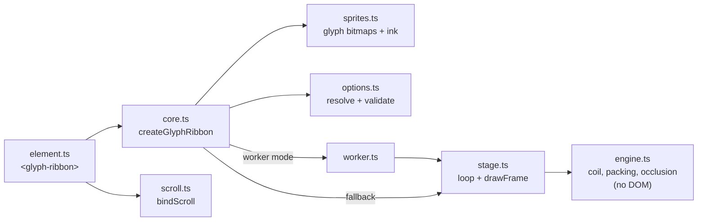
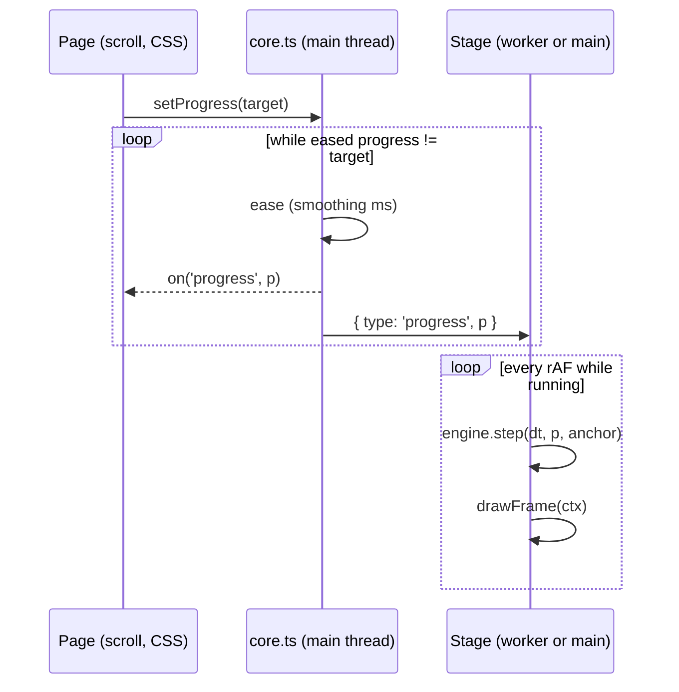
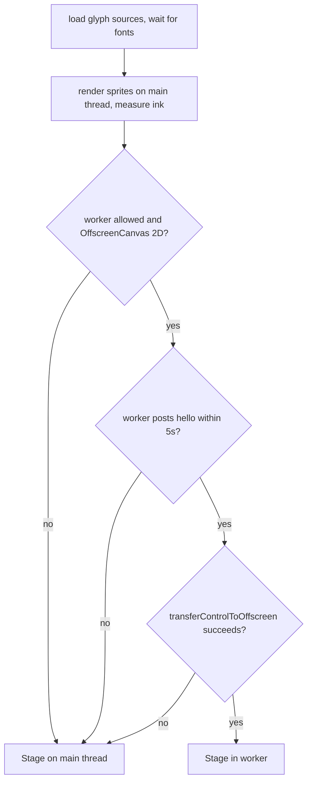

# Architecture

## Modules

`engine.ts` has no DOM dependencies. That makes it runnable in a worker, on the main thread, and in Node for tests.

## Who does what each frame

The main thread only eases a number and posts it. Placement, occlusion and drawing for every glyph happen in the stage. Progress events fire on the main thread, so a consumer's headline fade never waits on a worker round-trip.

## Startup and fallback

- **Sprites render on the main thread.** Web fonts already loaded by the page then work without loading them again in the worker. The bitmaps are transferred to the stage.
- **Ink radius is measured** by scanning each sprite's alpha. It feeds both the packing and the occlusion test, so custom glyphs space themselves correctly.
- **The canvas is transferred only after the worker answers.** Transfer is one-way, so a failed worker would otherwise leave a canvas that can never be drawn on.

## Options and rebuilds

| Change | Effect |
| --- | --- |
| `glyphs`, `font` | Reload sources, re-render sprites, rebuild the packing |
| `color` (or CSS `color`) | Re-render sprites only |
| `seed`, `maxGlyphs`, `turns`, `advanced` | Rebuild the packing |
| `speed`, `timeline`, `motion` | Runtime update, no rebuild |
| `anchor`, `smoothing` | Main thread only |

Rebuilds never replay the intro.

## Reduced motion

Under reduced motion, the coil does not drift, zoom, glide to centre or scatter. Progress through the `scatter` range fades glyphs out in reverse draw order. Glyphs drawn last vanish first, so a glyph that was hidden behind another never pops into view.

## Testing

`computeFrame` steps an engine from t=0 in fixed 16 ms increments. Visibility settles over frames, so a fixed step is what makes a frame reproducible. `test/engine.test.ts` snapshots compact digests of a few frames, and adds property tests:

- fully visible glyphs on one plane never overlap
- reduced motion never moves a glyph
- the dissolve reaches zero

One Playwright smoke test covers the worker path, the main-thread fallback and the playground.
